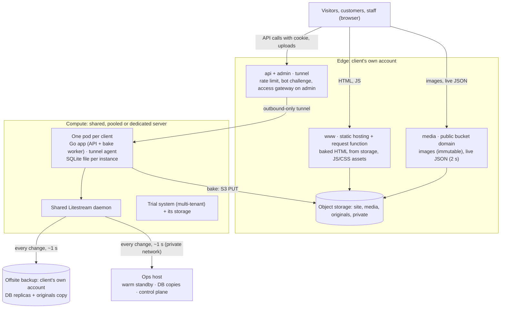

# Client apps: architecture and serving

Public pages never touch a server: they are baked to HTML and served by the **edge** from the client's own account. Servers only handle live actions (logins, forms, orders, bids) and baking, so if a server goes down every public site stays up. This doc is provider-neutral; the current edge is described in [adapters/cloudflare.md](adapters/cloudflare.md). Server side: [servers.md](servers.md).

## Diagram



Not drawn:
- **Code host:** the edge deploys the front from the client's repo, and servers pull API images from the client's container registry.
- **Private network:** the only way into servers and the control plane. Servers have no open inbound port ([operations.md](operations.md#private-network)).

## Ownership

| Component | Role | Owned by |
| --- | --- | --- |
| Domain, DNS, static hosting, object storage, tunnels, access gateway | Edge | Client |
| Database replicas, copies of image originals | Offsite backup | Client |
| Repo, CI, container images | Code host | Client |
| API instances | Compute (shared, pooled; dedicated = the client's own account) | Briolink (dedicated: client) |
| Trial system | Compute | Briolink |
| Warm standby, control plane | Ops host | Briolink |

Clients can leave with everything (decision 3).

## Environments and hostnames

Each client has two complete environments, **preview** and **production**, each with its own hostnames, buckets, site project, instance, database and tunnel. They share only the code, and preview doubles as staging.

| Role | Production | Preview | Protection |
| --- | --- | --- | --- |
| Site (baked HTML + assets) | `www.<domain>` | `preview.<domain>` | Prod: edge defaults. Preview: access gateway + `X-Robots-Tag: noindex` |
| Media | `media.<domain>` | `preview.<domain>/media/*` (through the request function, so the gateway covers it) | As above |
| API | `api.<domain>` | `preview-api.<domain>` | Prod: rate limit, bot challenge on login and sign-up. Preview: access gateway |
| Back office | `admin.<domain>` | `preview-admin.<domain>` | Access gateway (staff e-mails) + TOTP login |
| Apex | `<domain>` → 301 to www | — | — |

- **One label deep only** (`preview-api.`, not `api.preview.`), so common free edge certificates cover every name.
- **Canonical host:** keep whatever the old site used, to preserve search rankings.
- **Branches:** preview deploys `main`; production deploys `production`. A release fast-forwards `production` to a tagged commit, and that is a founder action.
- **Preview apps run on demand:** started by a deploy or from the control center, stopped after 24 h without use.

**Config flows one way.**
1. The instance's `.env` holds `SITE_ORIGIN`, `API_ORIGIN`, `MEDIA_ORIGIN`, `ROBOTS`, `ENV`, and the storage endpoint, keys and bucket.
2. The baker writes the public values into every page as `<meta name="app-config">`, and JS modules read them from there.
3. The edge's request function gets the same values as environment variables.

Changing the domain is a config change plus a full re-bake; that is how a preview or a trial becomes production.

## Stack

| Layer | Choice | Decision |
| --- | --- | --- |
| Front | Vanilla JS ES modules, tree-shaken and minified by esbuild at build, stable file names | 1, 70 |
| Edge | Any provider meeting the edge contract ([architecture.md](architecture.md#roles)); one small request function (~100 lines) | 2, 4, 65 |
| API | **Go**, standard library first (`net/http`, `html/template`) + the project's plugins; plumbing generated from the spec ([platform.md](platform.md#how-code-is-produced)); one binary per instance, bake worker inside | 39, 55, 64 |
| Database | **SQLite** (WAL) through `modernc.org/sqlite` (pure Go), one file per instance or tenant, `ATTACH` disabled | 21, 64 |
| Replication | **Litestream**: one shared daemon per server, replicas to the client's offsite backup and to the ops host; no LiteFS | 25, 52 |
| Images | The `media` plugin, options per project | 42, 69 |
| Containers | Rootless Podman + Quadlet in production (one pod per client); Docker Compose for development | 13, 23 |

**Why Go + SQLite:**
- ~15–30 MB per idle instance (12.5 MB measured in the pilot), against ~75–100 MB for PHP-FPM + nginx.
- No database server.
- Cheap long-lived connections for live features.
- One static binary for ARM and x86.
- Safe HTML templates.
- Each tenant is a plain file, so isolation and conversion stay simple.

**Trade-off:** Go developers are rarer than PHP/JS developers, so partner juniors work on templates and CSS only.

## Client repo layout (created from the template)

```text
<client>/                            client repo, in the client's own code host account
├── AGENTS.md                        same doc skeleton as this repo
├── api/                             Go module
│   ├── cmd/server/                  composition root: HTTP API, back office, bake worker
│   ├── spec/                        project.json (plugins + options), routes.json, queries/*.sql, domain/*.json
│   ├── gen/                         generated plumbing (DO NOT EDIT)
│   ├── internal/
│   │   ├── core/                    the minimal app core
│   │   ├── plugins/                 only the plugins selected in spec/project.json
│   │   └── domain/                  client-specific pure functions (coder model, via the runner)
│   ├── templates/                   html/template: layout, pages, account shells, 404, sitemap, robots
│   ├── migrations/                  numbered SQL files
│   └── tests/                       unit, black-box, e2e
├── app/
│   ├── public/                      static: ES modules (built by esbuild), CSS, fonts, headers file
│   └── edge/                        the request function, in the edge adapter's format
├── container/                       Containerfile (arm64 + amd64), Quadlet unit templates
├── compose.yaml                     dev stack
├── docs/                            client specs, decisions, bindings (the client's own accounts)
├── infra/                           provisioning root (from H2)
└── ops/                             instance.env.example, RUNBOOK.md
```

- **The core and the selected plugins are copied** into each client repo, so the client owns a complete working copy. Updates come plugin by plugin through the control plane's sync. The contract grants a perpetual licence to the core and those plugins.
- Secrets never enter the repo.
- CI files follow the code host adapter ([adapters/github.md](adapters/github.md)).

## What is baked and what is live

A page is re-baked within about a minute of a change that affects it. Anything that changes faster is fetched live instead. HTML is never cached at the edge, media files are immutable, and live JSON expires on its own, **so nothing ever needs a cache purge.**

| Data | Where it lives | How fresh |
| --- | --- | --- |
| Content pages (items, events, products, articles, static pages) | Baked HTML in the site bucket | Under 1 min after an edit |
| Search and filter index | Baked JSON: one file per section plus a small global index; split above ~300 KB gzipped | Same as pages |
| Live state (current bid, count, end time, stock) | `live/<id>.json` in the media bucket, rewritten after each change | 2 s edge TTL; the user's own action is confirmed in the POST response |
| Per-user data | API only, `Cache-Control: no-store` | Live |
| Results after an event | Baked when the event closes | Once |

With 1,000 viewers polling every 2 s, the server sees about one read per edge location every 2 s. If polling ever feels slow, the upgrade is an edge-side WebSocket service on the client's account; the edge adapter names one.

## Baking steps

1. **Record.** A domain write inserts a row into `bake_outbox(entity, entity_id, reason)` **in the same transaction**. A unique key on pending `(entity, entity_id)` merges repeated edits into one job.
2. **Claim.** The bake worker (a goroutine in the API binary) takes jobs one at a time. SQLite has a single writer, so two workers can never take the same job.
3. **Plan.** A pure function turns an entity into page keys. For example, an item gives its own page, its parent's page, the section index, the home page if featured, and the sitemap.
4. **Render.** With `html/template` (contextual escaping). Each output is hashed, and if the hash matches `baked_pages.sha256` the upload is skipped. That makes a full re-bake cheap.
5. **Publish.** S3 PUT, with `Content-Type` and `Cache-Control` stored as object metadata. The order is images, then pages, then index and sitemap, so no page ever points at a missing file.
6. **Remove.** An unpublished item is overwritten with a stub carrying custom metadata `status=410`, or `status=301` plus `location=…`, which the request function honours. The 301 map of the old site's URLs is a baked `redirects.json`.
7. **Re-bake everything.** Used after template changes, config changes and at launch. Safe to repeat.

The baker only uses the object-storage subset of the contract: PUT with metadata, conditional GET, HEAD, DELETE, list. No versioning, no conditional PUT.

## Images and files

Handled by the **`media` plugin**, chosen per project (decision 69). Formats, conversion, thumbnails and derived sizes are **options the architect sets for each project**; the defaults convert nothing and derive nothing.

**What the plugin always does:**
- **Upload path:** uploads go through the API, which needs the pixels anyway (duplicate hash, content check). The browser may encode a lighter format first when the project's options ask for it; the plugin checks the blob's real type.
- **Keys:** content-addressed (`img/<sha256>/<variant>.<ext>`), so a replaced file gets a new key and caches never go stale.
- **Metadata:** EXIF orientation applied; metadata dropped from public images unless an option keeps it on private ones.
- **Private files** (ID scans, user-submitted documents, invoices…) go to a private bucket and are never served statically. An API route checks the session, then redirects to a **5-minute presigned GET URL** (decision 43).

**Options set per project:**

| Option | Default | Example values (the first client's profile, decision 42) |
| --- | --- | --- |
| Stored format and conversion codec | Keep the uploaded format; no codec | WebP, browser-encoded when possible, otherwise converted server-side at quality 75 by a codec adapter |
| Thumbnail | None | 300 px at upload |
| Derived sizes at bake time | None | 480, 960, 1600 px with `srcset`, plus a 1200×630 `og:image` JPEG |
| Master | Kept as uploaded | Kept in the private originals bucket |
| EXIF on private files | Dropped | Kept (GPS included) where location matters |
| Trial profile | Same as production | Master + thumbnail only (100 MB quota) |

## Tags in every public page

- `<title>`, meta description, and `<link rel="canonical">` built from `SITE_ORIGIN`.
- `og:title`, `og:description`, `og:url`, `og:type`, `og:locale` (the site's locales), an absolute `og:image` from `MEDIA_ORIGIN`, and `twitter:card=summary_large_image`.
- JSON-LD where it helps (`Event`, `Product`…).
- `hreflang` on multilingual sites; right-to-left languages get `dir="rtl"`.
- Preview and trial pages also carry `<meta name="robots" content="noindex">`.
- Link previews can't be tested behind the access gateway, so check og tags on the production host during the launch rehearsal.

## Serving contract

HTML goes through the edge's **request function**, bound to the site bucket. Images and live JSON come straight from the public media domain. The request function must, in order:

1. Redirect the provider's default hostnames: 301 to the canonical host in production, 403 in preview.
2. Normalise the path: a trailing slash or upper case gets a 301. `/` maps to `pages/index.html`, and `/items/123-name` maps to `pages/items/123-name.html`.
3. Apply `redirects.json` (cached in memory, refreshed every 60 s): 301.
4. Read the object with the request's conditional headers; a matching ETag returns 304.
5. Honour stub metadata (`status=410`, `status=301`). A missing key serves `pages/404.html` with status 404.
6. Set headers: `Cache-Control`, `ETag`, `X-Robots-Tag` from env, HSTS, `X-Content-Type-Options`, `Referrer-Policy`, and a CSP whose `connect-src` allows only the API and media origins.
7. In preview only, serve `/media/*` from the preview media bucket, so the gateway covers images too.

Assets never run the function.

**Trials** serve the same contract from the trial system. **One contract test** (URLs → expected status and headers) runs against every edge adapter, the trial system and preview, so they can't drift apart. The trial system skips redirect cases.

## Cache semantics

| Resource | Where | `Cache-Control` | Edge cache | How it changes |
| --- | --- | --- | --- | --- |
| Baked HTML | www | `public, max-age=0, must-revalidate` + ETag | None: storage is read on each request | Overwrite |
| Index JSON | www `/data/*.json` | `public, max-age=60, stale-while-revalidate=300` | None | Overwrite |
| Sitemap, robots, redirects | www | `public, max-age=3600` | None | Overwrite |
| JS modules, CSS | www `/assets/*` | `public, max-age=0, must-revalidate` | Static hosting | Next deploy |
| Fonts | www `/assets/fonts/*` | `public, max-age=31536000, immutable` | Static hosting | Renamed file only |
| Images | media `/img/*` | `public, max-age=31536000, immutable` | Yes, honouring origin TTL | Never: new content means a new key |
| Live JSON | media `/live/*` | `public, max-age=2` | Yes, honouring origin TTL | Expires after 2 s |
| API responses | api | `no-store` by default | Bypass | — |

Built modules keep **stable names**, not hashes, because baked pages reference module URLs and a deploy may remove the previous deployment's files.

## CORS, cookies and CSRF

The site and the API are different origins on the same site, so the API cookie counts as first-party.

**CORS headers on API responses:**

| Header | Value |
| --- | --- |
| `Access-Control-Allow-Origin` | The request's Origin, only if it is exactly `SITE_ORIGIN` or `ADMIN_ORIGIN` (never `*`, never an unchecked echo) |
| `Access-Control-Allow-Credentials` | `true` |
| `Access-Control-Allow-Methods` | `GET, POST, PUT, DELETE` |
| `Access-Control-Allow-Headers` | `Content-Type` |
| `Access-Control-Max-Age` | `7200` |
| `Vary` | `Origin` |

**Session cookie:** `__Host-sid=<random>; Path=/; Secure; HttpOnly; SameSite=Strict` (never `None`, decision 37).
- Host-only on `api.`.
- Sent only by `fetch(…, { credentials: 'include' })` from the client's own pages.
- Sessions are stored on the server: 14 days sliding for end users, 8 h for staff. The ID rotates at login. JS learns the login state from `GET /v1/me`.

**CSRF.** SameSite doesn't protect against sibling subdomains, so:
- every non-GET request must carry `Origin == SITE_ORIGIN` (or `ADMIN_ORIGIN`), and a write with no Origin is rejected;
- request bodies are JSON only, which forces a preflight;
- no user content is ever hosted on another subdomain of the client's domain.

**Abuse controls:** a bot challenge on sign-up, login and registration; an edge rate limit on `/v1/auth/*`; per-account limits in the app.

**Back office:** a static SPA on `admin.<domain>`, behind the access gateway, calling the API with credentials (`ADMIN_ORIGIN` is the second allowed origin). Staff logins add TOTP.

**Money** is stored and computed as integers in the currency's minor unit, and percentages in basis points. APIs may expose decimal numbers (decision 35).
